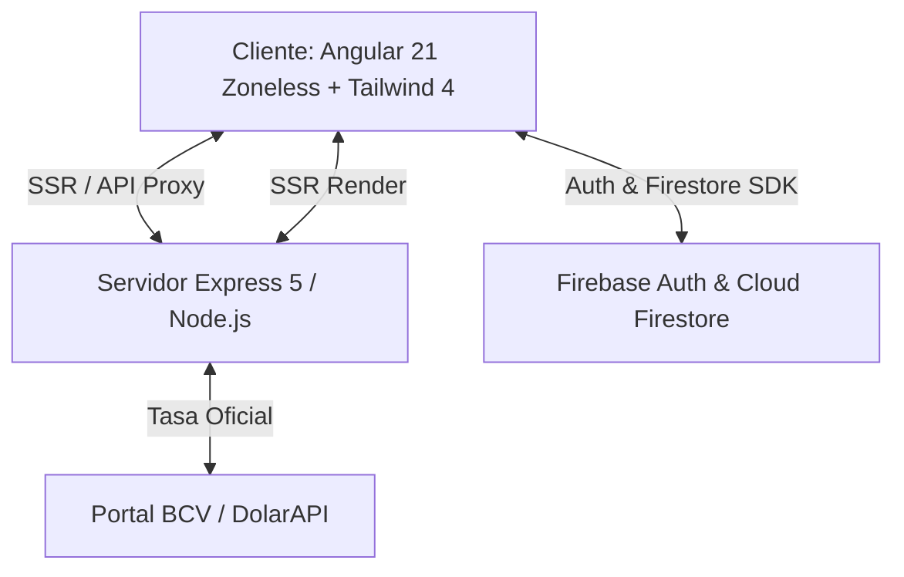

# Fintrack Pro — Gestión Inteligente de Gastos y Finanzas Personales

[](https://angular.dev/)
[](https://tailwindcss.com/)
[](https://firebase.google.com/)
[](https://www.typescriptlang.org/)
[](LICENSE)

**Fintrack Pro** es una plataforma web integral de gestión financiera personal y control de flujo de caja, concebida para adaptarse de manera precisa a la realidad económica de **Venezuela**. Incorpora arquitectura bimonetaria nativa (**USD / VES**), sincronización en tiempo real con la tasa oficial del **Banco Central de Venezuela (BCV)**, control automatizado de financiamientos quincenales por cuotas (**Cashea, Krece, Popclik**), administración multicuenta bancaria, presupuestos por categoría y reportes exportables en formato PDF y CSV.

---

## 📑 Tabla de Contenidos

- [Características Principales](#-características-principales)
  - [1. Motor Bimonetario y Tasa Oficial BCV](#1-motor-bimonetario-y-tasa-oficial-bcv)
  - [2. Módulo de Compras Financiadas BNPL (Cashea, Krece, Popclik)](#2-módulo-de-compras-financiadas-bnpl-cashea-krece-popclik)
  - [3. Gestión de Cuentas Bancarias y Efectivo](#3-gestión-de-cuentas-bancarias-y-efectivo)
  - [4. Flujo de Transacciones, Presupuestos y Analíticas](#4-flujo-de-transacciones-presupuestos-y-analíticas)
  - [5. Autenticación y Seguridad](#5-autenticación-y-seguridad)
- [Stack Tecnológico y Arquitectura](#-stack-tecnológico-y-arquitectura)
- [Estructura del Proyecto](#-estructura-del-proyecto)
- [Instalación y Configuración Local](#-instalación-y-configuración-local)
- [Variables de Entorno](#-variables-de-entorno)
- [Scripts Disponibles](#-scripts-disponibles)
- [Proceso de Despliegue e Implementación](#-proceso-de-despliegue-e-implementación)
- [Seguridad y Reglas de Firestore](#-seguridad-y-reglas-de-firestore)

---

## 🚀 Características Principales

### 1. Motor Bimonetario y Tasa Oficial BCV

- **Sincronización en Tiempo Real:** Servicio backend de scraping y consulta directa sobre el portal oficial del **Banco Central de Venezuela (`bcv.org.ve`)** con respaldo en **DolarAPI** y fallback inteligente en memoria.
- **Caché Stale-While-Revalidate:** Respuestas instantáneas en el cliente sin bloquear la navegación por latencia de red.
- **Conversión Universal Dinámica:** Conmutador global en el encabezado para alternar la visualización de balances, transacciones y cuotas entre Dólares estadounidenses (**$ USD**) y Bolívares (**Bs. VES**) calculados a la tasa del día.
- **Indicador de Fecha Valor:** Muestra la fecha oficial de vigencia emitida por el BCV.

### 2. Módulo de Compras Financiadas BNPL (Cashea, Krece, Popclik)

Diseñado específicamente para el ecosistema de financiamiento en cuotas quincenales vigente en el mercado venezolano:

- **Proveedores Compatibles:**
  - **Cashea:** Matriz completa de niveles (Nivel 1 al 5) con cálculo instantáneo de inicial porcentual (60%, 50%, 40%, 20% y 0% inicial).
  - **Krece:** Financiamiento en cuotas quincenales.
  - **Popclik:** Financiamiento digital.
  - **Proveedor Personalizado:** Ajuste libre de condiciones de financiamiento.
- **Plazos y Cuotas Flexibles:** Soporte nativo para 3, 6, 9 y 12 cuotas quincenales proyectadas a intervalos exactos de 14 días.
- **Deudas en Curso:** Permite registrar compras adquiridas con anterioridad indicando el número de cuotas que ya han sido canceladas para no duplicar compromisos pasados.
- **Cronograma y Reactividad Instantánea:** Vista previa en tiempo real del cronograma con fecha de vencimiento, monto en USD y contravalor en VES al modificar cualquier variable de la compra.
- **Widget de Próximos Vencimientos:** Monitoreo en el panel principal con alertas visuales de estado: _Pagada_, _Pendiente_, _Vence Pronto_ y _Vencida_.
- **Liquidación de Cuotas con Débito Bancario:** Al registrar el pago de una cuota, el sistema ofrece debitar automáticamente el monto de la cuenta bancaria seleccionada, registrando de forma coordinada el egreso correspondiente.

### 3. Gestión de Cuentas Bancarias y Efectivo

- **Multicuenta Bimonetaria:** Creación y administración de cuentas bancarias tanto en Bolívares (**VES**) como en Dólares (**USD**).
- **Cuenta de Efectivo por Defecto:** Cuenta predeterminada para el seguimiento del efectivo físico en mano.
- **Apertura con Saldo Inicial:** Permite definir un balance inicial al registrar una nueva cuenta, generando automáticamente una transacción de apertura auditada.
- **Consolidado de Balances:** Cálculo reactivo del patrimonio total neto expresado en la divisa preferida.

### 4. Flujo de Transacciones, Presupuestos y Analíticas

- **Registro Detallado:** Ingresos y egresos categorizados (Alimentación, Servicios, Salud, Transporte, Financiado/BNPL, Ocio, etc.).
- **Filtros Avanzados:** Búsqueda y filtrado por rango de fechas, cuenta bancaria, tipo de movimiento y categoría.
- **Control Presupuestario:** Definición de techos máximos de gasto con barras de progreso y alertas cuando el consumo excede el 70%, 90% o 100%.
- **Exportación de Datos:** Descarga de reportes financieros formales en **PDF** (con membrete y detalle) y exportación tabular en formato **CSV**.

### 5. Autenticación y Seguridad

- **Opciones de Ingreso:** Autenticación por correo y contraseña, autenticación con un clic mediante Google OAuth, y modo Invitado / Demo.
- **Experiencia de Usuario Fluida:** Formularios reactivos con validaciones visuales, animaciones de transición, pantalla de carga (_loader_) e ingreso automático al Dashboard tras el registro.
- **Aislamiento Multiusuario:** Cada usuario interactúa exclusivamente con sus propios documentos y subcolecciones en Firestore mediante reglas de seguridad estrictas.

---

## 🛠 Stack Tecnológico y Arquitectura



| Capa                       | Tecnología                    | Descripción                                                                                                                                             |
| :------------------------- | :---------------------------- | :------------------------------------------------------------------------------------------------------------------------------------------------------ |
| **Framework Frontend**     | **Angular 21.0.0**            | Aplicación zoneless de alto rendimiento, `ChangeDetectionStrategy.OnPush`, Angular Signals reactivos y componentes autónomos (_Standalone Components_). |
| **Estilos y UI**           | **Tailwind CSS v4**           | Utilidades modernas con `@tailwindcss/postcss`, paletas de contraste accesible, diseño responsivo y Angular Material Icons.                             |
| **Animaciones**            | **Motion (Vanilla JS)**       | Transiciones fluidas en modales, barras de progreso y estados interactivos.                                                                             |
| **Backend & SSR**          | **Express 5.1 & Angular SSR** | Servidor híbrido para Server-Side Rendering (`@angular/ssr/node`) y rutas API internas (`/api/bcv`).                                                    |
| **Base de Datos**          | **Cloud Firestore**           | Almacenamiento NoSQL en la nube con sincronización en tiempo real vía `onSnapshot` y resguardo local `SafeStorage`.                                     |
| **Autenticación**          | **Firebase Auth**             | Manejo de sesiones seguras mediante correo/contraseña, Google Sign-In y accesos anónimos.                                                               |
| **Generación de Reportes** | **jsPDF 4.2**                 | Renderizado programático de reportes imprimibles en PDF desde el cliente.                                                                               |
| **Tasas Cambiarias**       | **BCV Scraper + DolarAPI**    | Sistema híbrido de obtención de tasa oficial USD/VES con caché en memoria de 2 minutos.                                                                 |
| **Tipado y Calidad**       | **TypeScript 5.9 & ESLint**   | Modo estricto habilitado y auditoría de reglas de seguridad de Firestore con `@firebase/eslint-plugin-security-rules`.                                  |

---

## 📁 Estructura del Proyecto

```text
├── .aistudio/                  # Metadatos del entorno y artefactos de planificación
├── public/                     # Activos estáticos, favicon e imágenes
├── src/
│   ├── app/
│   │   ├── core/
│   │   │   ├── firebase/       # Servicio centralizado de Firebase (Auth, Firestore, Error Handling)
│   │   │   ├── guards/         # Guards de autenticación de rutas (authGuard)
│   │   │   ├── libraries/      # Utilitarios de exportación (PDF con jsPDF, CSV)
│   │   │   ├── pipes/          # Tuberías de formato de moneda (USD/VES) y fechas
│   │   │   └── utils/          # Almacenamiento seguro SafeStorage con fallback
│   │   ├── models/             # Interfaces de TypeScript (user, transaction, budget, bnpl, etc.)
│   │   ├── pages/
│   │   │   ├── auth/           # Vistas de Login, Registro y Recuperación de cuenta
│   │   │   ├── templates/      # Layout maestro, Header reactivo y Sidebar de navegación
│   │   │   └── views/
│   │   │       ├── dashboard/  # Dashboard principal (Métricas, Gráficos, Transacciones, Presupuestos, Cuentas, Deudas BNPL)
│   │   │       └── feature-components/ # Modales reactivos (BNPL Purchase, Pay Modal, Account Modal, Transaction Modal)
│   │   ├── services/           # Servicios inyectables (Auth, Finance, BCV, BNPL, Budget, BankSync, Theme)
│   │   ├── app.config.ts       # Proveedores cliente (Router, HttpClient, Zoneless)
│   │   ├── app.config.server.ts# Proveedores específicos del servidor
│   │   ├── app.routes.ts       # Definición de rutas y lazy loading de componentes
│   │   └── app.ts              # Componente raíz de la aplicación
│   ├── environments/           # Configuración de entornos y credenciales Firebase
│   ├── server/                 # Módulos del servidor backend (bcv.ts para tasas cambiarias)
│   ├── main.server.ts          # Punto de entrada para SSR con BootstrapContext
│   ├── main.ts                 # Bootstrap de la aplicación Angular en navegador
│   ├── server.ts               # Servidor Express que encapsula SSR y endpoints /api
│   └── styles.css              # Importación de Tailwind CSS v4 y estilos globales
├── angular.json                # Configuración de Angular CLI y builders de producción
├── firebase-blueprint.json     # Esquema de diseño de colecciones de Firestore
├── firestore.rules             # Reglas de seguridad declarativas de Firestore
├── package.json                # Dependencias del proyecto y scripts de ejecución
└── tsconfig.json               # Configuración del compilador TypeScript
```

---

## 💻 Instalación y Configuración Local

### Requisitos Previos

- **Node.js**: Versión `20.x` o superior (Recomendado Node 20 LTS o 22 LTS).
- **npm**: Versión `10.x` o superior.

### Pasos de Instalación

1. **Clonar el repositorio:**

   ```bash
   git clone <URL_DEL_REPOSITORIO>
   cd fintrack-pro
   ```

2. **Instalar dependencias:**

   ```bash
   npm install
   ```

3. **Configurar variables de entorno:**
   Cree un archivo `.env` en la raíz del proyecto basándose en `.env.example`:

   ```bash
   cp .env.example .env
   ```

4. **Configurar Credenciales de Firebase:**
   Verifique que los datos del proyecto en `src/environments/environment.ts` correspondan con su consola de Firebase:

   ```typescript
   export const environment = {
     production: false,
     apiUrl: '/api',
     firebaseConfig: {
       apiKey: 'TU_API_KEY',
       authDomain: 'tu-proyecto.firebaseapp.com',
       projectId: 'tu-proyecto',
       storageBucket: 'tu-proyecto.firebasestorage.app',
       messagingSenderId: 'TU_MESSAGING_ID',
       appId: 'TU_APP_ID',
       firestoreDatabaseId: '(default)',
     },
   };
   ```

5. **Iniciar el servidor de desarrollo:**
   ```bash
   npm run dev
   ```
   Abra su navegador en [http://localhost:3000](http://localhost:3000).

---

## 🔐 Variables de Entorno

El archivo `.env.example` documenta las variables requeridas en tiempo de ejecución:

| Variable         | Requerida | Propósito                                                                                                  |
| :--------------- | :-------: | :--------------------------------------------------------------------------------------------------------- |
| `GEMINI_API_KEY` | Opcional  | Clave para llamadas a la API de Gemini (en caso de habilitar asistentes o categorización predictiva).      |
| `APP_URL`        | Opcional  | URL base del despliegue (inyectada automáticamente en Cloud Run para links y callbacks).                   |
| `PORT`           | Opcional  | Puerto de escucha del servidor Express (por defecto `3000` en desarrollo y `4000` o `8080` en producción). |

---

## 📜 Scripts Disponibles

En el archivo `package.json` se encuentran disponibles los siguientes comandos:

- `npm run dev`: Inicia el servidor de desarrollo en `http://0.0.0.0:3000` con soporte para Angular SSR y live-reload.
- `npm run build`: Compila la aplicación completa para producción (bundle del cliente en `dist/app/browser` y bundle del servidor en `dist/app/server`).
- `npm run serve:ssr:app`: Ejecuta el servidor Node.js Express de producción usando el bundle generado en `dist/app/server/server.mjs`.
- `npm run lint`: Ejecuta el linter estático de código Angular, TypeScript y las reglas de seguridad de Firestore.
- `npm run test`: Ejecuta la suite de pruebas unitarias con Vitest.

---

## 🚢 Proceso de Despliegue e Implementación

### Opción 1: Despliegue en Google Cloud Run / Contenedor Docker

La aplicación está diseñada para operar como una solución Full-Stack autónoma con Express y Angular SSR.

1. **Construir los artefactos de producción:**

   ```bash
   npm run build
   ```

2. **Estructura del contenedor Docker (Ejemplo de Dockerfile multi-stage):**

   ```dockerfile
   FROM node:20-alpine AS builder
   WORKDIR /app
   COPY package*.json ./
   RUN npm ci
   COPY . .
   RUN npm run build

   FROM node:20-alpine AS runner
   WORKDIR /app
   ENV NODE_ENV=production
   ENV PORT=8080
   COPY package*.json ./
   RUN npm ci --omit=dev
   COPY --from=builder /app/dist ./dist
   EXPOSE 8080
   CMD ["node", "dist/app/server/server.mjs"]
   ```

3. **Construir y desplegar en Google Cloud Run:**
   ```bash
   gcloud builds submit --tag gcr.io/TU_PROJECT_ID/fintrack-pro
   gcloud run deploy fintrack-pro \
     --image gcr.io/TU_PROJECT_ID/fintrack-pro \
     --platform managed \
     --region us-east1 \
     --allow-unauthenticated \
     --port 8080
   ```

---

## 🛡 Seguridad y Reglas de Firestore

Las reglas definidas en `firestore.rules` siguen el principio de **menor privilegio** (_Principle of Least Privilege_):

1. **Aislamiento por Usuario:** Todo documento creado bajo la ruta `/users/{userId}/...` exige de forma estricta que `request.auth.uid == userId`.
2. **Subcolecciones Protegidas:**
   - `/users/{userId}/accounts/{accountId}`
   - `/users/{userId}/transactions/{transactionId}`
   - `/users/{userId}/budgets/{budgetId}`
   - `/users/{userId}/bnpl_purchases/{purchaseId}`
   - `/users/{userId}/notifications/{notificationId}`
3. **Validación de Esquema e Integridad:** Los pagos de cuotas y transacciones deben mantener correspondencia con las cuentas y montos declarados por el usuario activo.

Para desplegar las reglas a su proyecto de Firebase:

```bash
firebase deploy --only firestore:rules
```

---

## 👥 Soporte y Contribuciones

Para reportar problemas o solicitar nuevas funcionalidades, abra un issue en el repositorio o comuníquese con el equipo de desarrollo.

**Fintrack Pro** — _Control financiero inteligente, bimonetario y adaptado a tus necesidades._
